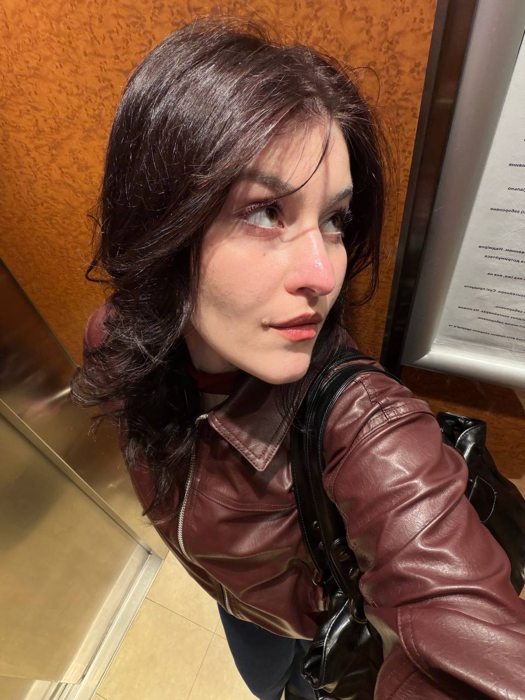

<!-- Репозиторий должен называться darianikiporets (как твой GitHub username) и быть публичным -->
<!-- Фото: загрузи в этот же репозиторий файл photo.jpg (лучше квадратное, лицо по центру) -->

<div align="center">

<div align="center">  <table> <tr> <td align="center" valign="middle">
```
> python · sql · matlab · statistics
> seeking a data science / AI / software internship
```

[](https://www.linkedin.com/in/daria-nikiporets-19b3a2402/)
[](mailto:darianikiporetsugc@gmail.com)


</td>
<td align="center" valign="middle" width="190">



</td>
</tr>
</table>

</div>

## 🎧 about

```python
daria = {
    "does":        "data science, AI, and software development",
    "based":       "Dublin, Ireland",
    "studying":    "BSc Data Science & AI @ TU Dublin (2nd year)",
    "core":        ["Python", "SQL", "MATLAB", "Statistics"],
    "math":        "linear algebra, calculus, statistical reasoning",
    "community":   "Social Events Officer @ TU Dublin CS Society",
    "outside_code": ["dance & choreography", "music"],
    "rule":        "turn real life into structured data, then ask good questions.",
    "looking_for": "Data Science / AI / Software Development internship",
    "contact":     "darianikiporetsugc@gmail.com",
    "pronouns":    "she/her",
}
```

A second-year Data Science & AI student with a foundation in mathematics, programming and data analytics, hands-on experience with databases and web development, and an interest in applying analytical thinking to real-world problems.

## 🛠 skills

| Category | Skills |
|---|---|
| **Programming** | Python, C, SQL, MATLAB, JavaScript, PHP |
| **Data Analysis** | Pandas, Matplotlib, Data Cleaning, EDA, Data Visualization, Statistical Analysis, Data Validation |
| **Web Development** | HTML5, CSS3, JavaScript, PHP |
| **Databases** | MySQL, SQLite, Database Design, SQL Queries, CRUD |
| **Tools** | Git, GitHub, Excel, Miro |
| **Mathematics** | Linear Algebra, Calculus, Statistics |

## 🚀 projects

| | |
|---|---|
| 💃 **Choreography Creativity Analysis**<br><sub>personal data project</sub><br>Tracks my own dance sessions as a dataset (duration, music, genre, location, ideas created, creativity rating) to explore what drives creative output.<br><br>`Python` `Pandas` `Matplotlib` | 📚 **Book Reservation System**<br><sub>university project</sub><br>Web system for managing a book catalogue and reservations: relational database design, SQL queries, CRUD operations, PHP backend and a front-end interface.<br><br>`PHP` `MySQL` `HTML` `CSS` `JavaScript` |
| 📊 **Data Exploration & Analysis**<br><sub>university coursework</sub><br>Exploring numerical and categorical features, distributions and class balance, and presenting the findings.<br><br>`Python` `Statistics` `Data Visualization` | 🧑‍🤝‍🧑 **Pilot Persona (Human-Computer Interaction)**<br><sub>group coursework</sub><br>Designed a user research plan and built a pilot persona collaboratively on a Miro board.<br><br>`Miro` `UX research` |

## 💼 experience & activities

| Role | What I did |
|---|---|
| **Till Operator / Retail Assistant**<br><sub>Aviva Stadium · Aug 2026 – present</sub> | Customer transactions, cash and card payments and customer service at busy events, while keeping accuracy under pressure. Hospitality trained. |
| **Social Events Officer**<br><sub>TU Dublin Computer Science Society · 2025 – 2026</sub> | Organised social events for students, coordinated with the team and helped grow the CS community. |

## 🎓 education

**BSc Data Science & Artificial Intelligence**, Technological University Dublin · 2025 – present

Programming · Data Exploration · Mathematics · Statistics · Computer Systems · Web Development · Database Management · Human-Computer Interaction · Sustainable Data Science & AI

<!-- Когда будут точные данные, добавь строкой выше:
Expected graduation: 20XX · GPA X.X/4.0 (только актуальный, подтверждённый) -->
